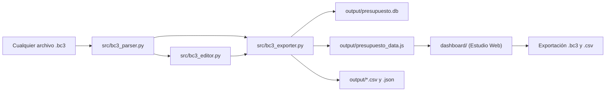

<p align="center">
  <picture>
    <source media="(prefers-color-scheme: dark)" srcset="dashboard/assets/logo/arqmed-lockup-dark.svg">
    
  </picture>
</p>

<p align="center">
  <strong>Parser bidireccional y editor web para presupuestos de construcción FIEBDC-3 (.BC3)</strong>
</p>

<p align="center">
  <a href="pyproject.toml">= 3.10"></a>
  <a href="pyproject.toml"></a>
  <a href="LICENSE"></a>
</p>

ARQMED Studio es un parser bidireccional y editor web para archivos `.bc3` bajo el estándar FIEBDC-3 (Formato de Intercambio Estándar de Bases de Datos de la Construcción, utilizado en España para presupuestos y mediciones de obra).

Los programas habituales de presupuestos de construcción son aplicaciones de escritorio cerradas para Windows. Este proyecto permite leer cualquier archivo `.bc3` desde Python sin dependencias externas, exportar toda su estructura a SQLite, JSON o CSV, y editar precios, descomposiciones, mediciones y pliegos directamente en el navegador con recálculo automático de importes.

## Qué resuelve

- Lectura universal de cualquier archivo `.bc3` codificado en `UTF-8`, `Windows-1252 (ANSI)` o `CP850 (DOS)`, resolviendo sinónimos de códigos y referencias cruzadas sin depender de nombres de capítulos ni estructuras fijas.
- Desglose completo de capítulos, subcapítulos multinivel, partidas, precios auxiliares, materiales, maquinaria y mano de obra.
- Recálculo en cascada: al cambiar un precio unitario o una línea de medición, el motor actualiza los importes parciales hacia arriba hasta el total de la obra y recalcula los pesos porcentuales hacia abajo.
- Simulación de impacto antes de guardar: si un material o recurso aparece en varias partidas del presupuesto, puedes ver cuánto varía cada partida (`Δ €`) y elegir en qué filas aplicar el cambio (`OK`) y en cuáles mantener el precio original (`NO`).
- Edición en el navegador sin servidor de base de datos: la interfaz web guarda los presupuestos en `IndexedDB`, mantiene historial de deshacer y rehacer, y exporta el resultado de vuelta a un archivo `.bc3` válido o a `.csv`.

## Inicio rápido

```bash
git clone https://github.com/alvarofdezr/Arqmed.git
cd Arqmed
python -m http.server 8080
```

Abre `http://localhost:8080` en tu navegador. También puedes abrir directamente el archivo `dashboard/index.html` haciendo doble clic o arrastrar cualquier archivo `.bc3` desde tu equipo sobre la ventana para importarlo y trabajar con él al instante.

## Requisitos e instalación

- **Python**: `>= 3.10` (usa únicamente la librería estándar en producción: `sqlite3`, `csv`, `json`, `re`, `pathlib`).
- **Node.js**: `>= 18` (opcional, necesario solo para ejecutar los tests unitarios de la barra de menús).
- **Sistema operativo**: Windows, macOS o Linux.

Para instalar el paquete en modo editable junto con `pytest` para desarrollo:

```bash
pip install -e ".[dev]"
```

## Uso desde línea de comandos (CLI)

El paquete registra el comando `arqmed-export` (también invocable como módulo con `python -m src.bc3_exporter`). Puedes pasarle la ruta de cualquier archivo `.bc3` y la carpeta de destino:

```bash
python -m src.bc3_exporter ruta/a/tu_presupuesto.bc3 output
```

Si lo ejecutas sin argumentos (`arqmed-export` o `python -m src.bc3_exporter`), detecta automáticamente el primer archivo `.bc3` disponible en `data/` y genera los cinco artefactos en `output/`:

```text
Exported BC3 'presupuesto_demo.bc3' to 'output':
  - sqlite: output/presupuesto.db (2,240,512 bytes)
  - json: output/presupuesto_completo.json (4,085,114 bytes)
  - js_bundle: output/presupuesto_data.js (3,190,420 bytes)
  - matrix_csv: output/matriz_presupuesto.csv (1,045,810 bytes)
  - measurements_csv: output/mediciones_detalle.csv (498,120 bytes)
```

## Uso de la API en Python

Todas las funciones principales se exportan desde `src` y operan de forma dinámica sobre cualquier archivo `.bc3`:

### 1. Leer cualquier archivo `.bc3` y consultar sus totales

```python
from pathlib import Path
from src import parse_bc3_file
from src.bc3_exporter import resolve_default_bc3_path

bc3_path = resolve_default_bc3_path(Path("."))
data = parse_bc3_file(bc3_path)
meta = data["metadata"]

print(meta["root_code"])
print(meta["root_total"])
print(meta["max_chapter_depth"])
print(meta["counts"]["roles"])
```

### 2. Simular el impacto de cambiar un precio y aprobarlo selectivamente

Cuando un recurso compartido cambia de precio, puedes previsualizar el impacto en todas las partidas donde interviene y aplicar el cambio únicamente en las filas aprobadas. El motor crea automáticamente un código variante (`_V1`) para no alterar las partidas rechazadas:

```python
from pathlib import Path
from src import (
    apply_selective_concept_edit,
    parse_bc3_file,
    preview_concept_edit,
)
from src.bc3_exporter import resolve_default_bc3_path

data = parse_bc3_file(resolve_default_bc3_path(Path(".")))

recurso = next(
    r for r in data["budget_matrix"]
    if r["node_role"] == "MATERIAL" and r["unit_price"] > 0
)
nuevo_precio = round(recurso["unit_price"] * 1.15, 2)

impact = preview_concept_edit(data, code=recurso["code"], new_price=nuevo_precio)
print(f"Apariciones: {impact['occurrences_count']}")
print(f"Diferencia si se aprueban todas: {impact['delta_if_all_approved']} EUR")

primera_fila_id = impact["occurrences"][0]["row_id"]
updated = apply_selective_concept_edit(
    data,
    code=recurso["code"],
    approved_row_ids={primera_fila_id},
    new_price=nuevo_precio,
)

print(f"Nuevo total presupuesto: {updated['metadata']['root_total']} EUR")
```

### 3. Modificar líneas de medición y exportar de vuelta a `.bc3`

```python
from pathlib import Path
from src import export_bc3_string, parse_bc3_file, update_measurement_lines
from src.bc3_exporter import resolve_default_bc3_path

data = parse_bc3_file(resolve_default_bc3_path(Path(".")))
partida = next(r for r in data["budget_matrix"] if r["node_role"] == "PARTIDA")

nuevas_lineas = [
    {
        "line_index": 1,
        "line_type": "",
        "comment": "Zona ampliada norte",
        "units": 2.0,
        "length": 50.0,
        "width": 20.0,
        "height": None,
    }
]

actualizado = update_measurement_lines(data, partida["row_id"], nuevas_lineas)
contenido_bc3 = export_bc3_string(actualizado)

with open("output/presupuesto_editado.bc3", "w", encoding="utf-8") as f:
    f.write(contenido_bc3)
```

## Atajos de teclado en el estudio web

| Acción | Atajo |
|---|---|
| Importar archivo `.bc3` | `Ctrl+O` |
| Exportar presupuesto actual a `.bc3` | `Ctrl+S` |
| Deshacer último cambio | `Ctrl+Z` |
| Rehacer cambio | `Ctrl+Y` o `Ctrl+Shift+Z` |
| Buscar en el árbol del presupuesto | `Ctrl+K` |
| Editar el concepto seleccionado | `F2` |
| Añadir concepto hijo al nodo actual | `Insert` |
| Eliminar fila seleccionada | `Supr` |
| Mover fila arriba / abajo | `Alt+↑` / `Alt+↓` |
| Navegar y plegar/desplegar nodos | `↑` `↓` `←` `→` |

## Arquitectura y estructura



```text
.
├── data/
│   └── presupuesto_demo.bc3               # Presupuesto FIEBDC-3 anonimizado de demostración
├── dashboard/
│   ├── assets/                            # Iconos y logotipos en formato SVG y PNG
│   ├── app.js                             # Árbol, paneles modulares, recálculo e IndexedDB
│   ├── menubar.js                         # Barra de menús, diálogos y gestor de atajos
│   ├── index.html                         # Entrada principal del estudio ARQMED
│   └── styles.css                         # Hojas de estilo y temas claro/oscuro
├── output/
│   └── presupuesto_data.js                # Bundle JS precompilado para carga inmediata
├── src/
│   ├── __init__.py                        # Funciones públicas exportadas
│   ├── bc3_parser.py                      # Lector universal de registros ~V, ~K, ~C, ~D, ~T, ~M, ~X
│   ├── bc3_editor.py                      # Recálculo en cascada, variantes y serializador
│   └── bc3_exporter.py                    # Generador de SQLite, JSON, CSV y bundle JS
├── tests/
│   ├── menubar.test.js                    # Pruebas unitarias de menús y atajos (Node.js)
│   ├── test_bc3_editor.py                 # Pruebas dinámicas de edición y roundtrip BC3
│   ├── test_bc3_exporter.py               # Pruebas dinámicas de exportación SQLite, CSV y JS
│   └── test_bc3_parser.py                 # Pruebas dinámicas de lectura jerárquica y mediciones
├── index.html                             # Redirección desde la raíz hacia dashboard/index.html
├── LICENSE                                # Licencia MIT
└── pyproject.toml                         # Configuración del paquete y de pytest
```

## Alcance y limitaciones

- **Qué hace**: procesa cualquier archivo bajo el estándar FIEBDC-3 (`~V`, `~K`, `~C`, `~D`, `~T`, `~M`, `~X`), recalcula presupuestos con precisión decimal, permite editar mediciones y pliegos en local y exporta archivos `.bc3` compatibles con programas de mediciones.
- **Qué no hace**:
  - No incluye un servidor backend multiusuario ni sincronización en la nube; cada usuario trabaja sobre su propia biblioteca local en el navegador (`IndexedDB`).
  - No renderiza planos gráficos ni diagramas geométricos asociados a registros `~G` o archivos adjuntos externos.
  - No evalúa fórmulas algebraicas personalizadas dentro de comentarios de medición; calcula subtotales multiplicando las dimensiones presentes (`Uds × Longitud × Anchura × Altura`) e ignora las líneas marcadas como subtítulos o zonas.

## Pruebas y contribución

Para verificar tanto el motor Python como la lógica de menús en JavaScript antes de abrir un Pull Request:

```bash
python -m pytest tests -v
node --test tests/menubar.test.js
```

Si encuentras un archivo `.bc3` que produzca un error de lectura o un descuadre en el recálculo, abre un issue indicando la cabecera `~V` y `~K` del archivo y un fragmento mínimo reproducible con los registros `~C`, `~D` y `~M` implicados.

## Licencia

Este proyecto se distribuye bajo la [Licencia MIT](LICENSE).
